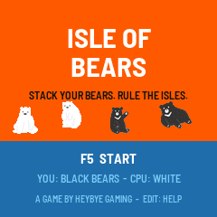
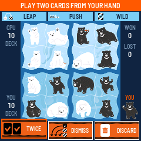

# Isle of Bears for the M-VAVE FM-1

[Isle of Bears](https://isle-of-bears.heybyedesign.com) (熊之島), HEYBYE GAMING's two-player stacking card game, as
custom firmware for the M-VAVE FM-1 pocket synth: you (the black bears) against the computer (the white), on the
FM-1's own 240 × 240 screen, keys and speaker.

  

## Playing

| Key | |
| --- | --- |
| F3 / A3 | left / right |
| F#3 (or G#3) / G3 | up / down (choosing a push direction, two held together make a diagonal) |
| SELECT knob | next / previous choice |
| F5 (or PLAY) | pick, play the card, confirm the turn |
| G5 | take the turn back (until it is confirmed) |
| EDIT | the controls, then the rulebook as a QR code for your phone |
| HOME | the title |

Pick a card from your hand, then follow the prompt at the top: only the cells framed in white can be picked, and
the cursor jumps between them. When the card is done, F5 confirms it (G5 takes it back). The cells the computer
touched stay framed in orange until you play. The full rules: <https://isle-of-bears.heybyedesign.com/rules-en.pdf>.

In the browser emulator (`./build.sh --web`): the arrows are the pad, Enter or Space is F5, Backspace is G5.

## How it is made

| Path | |
| --- | --- |
| `app/iob.h` | The rules, a line-for-line C port of the web version's engine |
| `app/iob_ai.h` | The computer: the web version's search (every turn it could play, the best 30 checked against every reply), as an explicit stack that runs in ~9 ms slices so the screen never freezes |
| `app/app.c` | Screen, controls, the computer's turn played step by step, sound, the win/loss record (kept in flash) |
| `app/art.h` | The isles, bears and cards as RGB565 sprites, and the rulebook's QR code (`tools/gen_art.py`) |
| `tests/oracle.mjs` | The rules played against the web version's engine, step by step: every state and every set of legal moves compared (20,000+ games, identical) |
| `tests/ai_test.c` | The computer against random play (it wins them all) and against itself |
| `app/tests/*.txt` | Host simulator scripts: keys, screenshots, checks, a whole game |

Built on [fm1-base](https://github.com/charlesvestal/fm1-base) (platform, host simulator, browser emulator,
installer) and [felucca-bsp](https://github.com/hugelton/felucca-bsp); the controls follow
[Mighty Arcade](https://github.com/NickCulbertson/FM1-Mighty-Arcade)'s. Inspired by
[fm1-doom](https://github.com/seanohollaren/fm1-doom).

## Building

```
git clone --recursive https://github.com/richardvt/isle-of-bears-fm1
./build.sh --test        # self-play and the simulator scripts (and the oracle, with the web version beside it: IOB_WEB)
./build.sh --host        # the host simulator
./build.sh --web         # the browser emulator, app/build/emu/ (Emscripten)
./build.sh               # app/build/IsleOfBears.fwsc (Docker and JieLi's toolchain: base/tools/setup_toolchain.sh)
python3 base/tools/fm1_install.py app/build/IsleOfBears.fwsc   # install it over USB-MIDI
```

Installing replaces the FM-1's firmware; do it at your own risk. fm1-base's installer can put M-VAVE's own firmware
back, and an FM-1 that fails to start twice comes up in a safe mode the installer can reach.

## Licensing

Code: MPL-2.0. The art in `app/art.h` and `app/docs/img/` is HEYBYE GAMING's, all rights reserved. See
[LICENSING.md](LICENSING.md). M-VAVE and FM-1 are trademarks of their owners; not affiliated with M-VAVE or
Hügelton Instruments.

---

## 中文說明

熊之島的 FM-1 自製韌體：用 FM-1 的螢幕、琴鍵和喇叭，玩家（黑熊）對電腦（白熊）。最低的幾個鍵當十字鍵（F3 左、A3 右、F#3 上、G3 下），
F5 選取／出牌／確認，G5 撤回，EDIT 看操作說明，再按一次顯示規則書 QR 碼，用手機掃描開啟。規則引擎與網頁版逐步對拍，結果完全一致。
